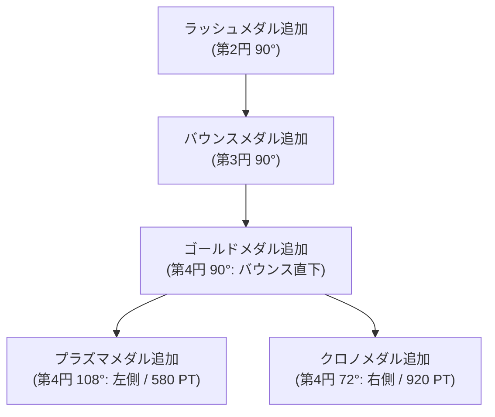

# 実装計画書 (implementation_plan.md) — メダル開放ラインのT字分岐再編

## 1. 概要
スキルツリー下部（6時方向）のメダル開放ラインを、一筆書き円弧から **「ラッシュ → バウンス → 直下にゴールド → 左右にプラズマ・クロノ」のT字分岐（アンカー型）** へ再編しました。
ゴールドから左右のプラズマ（580 PT）とクロノ（920 PT）が同時に解放可能になりますが、コスト差によりプラズマから取得する自然なゲーム体験を実現しました。

---

## 2. 実装仕様の詳細

- **`medal_2`（バウンスメダル追加）**:
  - 座標: `...polar(ORBIT_R3, 90)`
  - neighbors: `['medal_1', 'medal_3']`
- **`medal_3`（ゴールドメダル追加）**:
  - 座標: `...polar(ORBIT_R4, 90)` （※バウンスの真下へ直進配置）
  - neighbors: `['medal_2', 'star_3', 'medal_5']` （※左右へ2分岐）
  - baseCost: 360 PT
- **`star_3`（プラズマメダル追加）**:
  - 座標: `...polar(ORBIT_R4, 108)` （※ゴールドの左側）
  - neighbors: `['medal_3']`
  - baseCost: 580 PT
- **`medal_5`（クロノメダル追加）**:
  - 座標: `...polar(ORBIT_R4, 72)` （※ゴールドの右側）
  - neighbors: `['medal_3']`
  - baseCost: 920 PT

---

## 3. 検証結果
- **型チェック**: `npx tsc --noEmit` エラーゼロ。
- **本番ビルド**: `npm run build` 正常終了。
- **実機ビジュアル検証**: [`shot_tree_medal_t_branch.png`](file:///C:/Users/SHOOO/.gemini/antigravity/brain/f40757a3-4abf-45b2-9309-573f2a74b7ec/shot_tree_medal_t_branch.png) にて、バウンス直下にゴールドが直進配置され、そこから左右のプラズマとクロノへ美しくT字分岐していることを確認。
