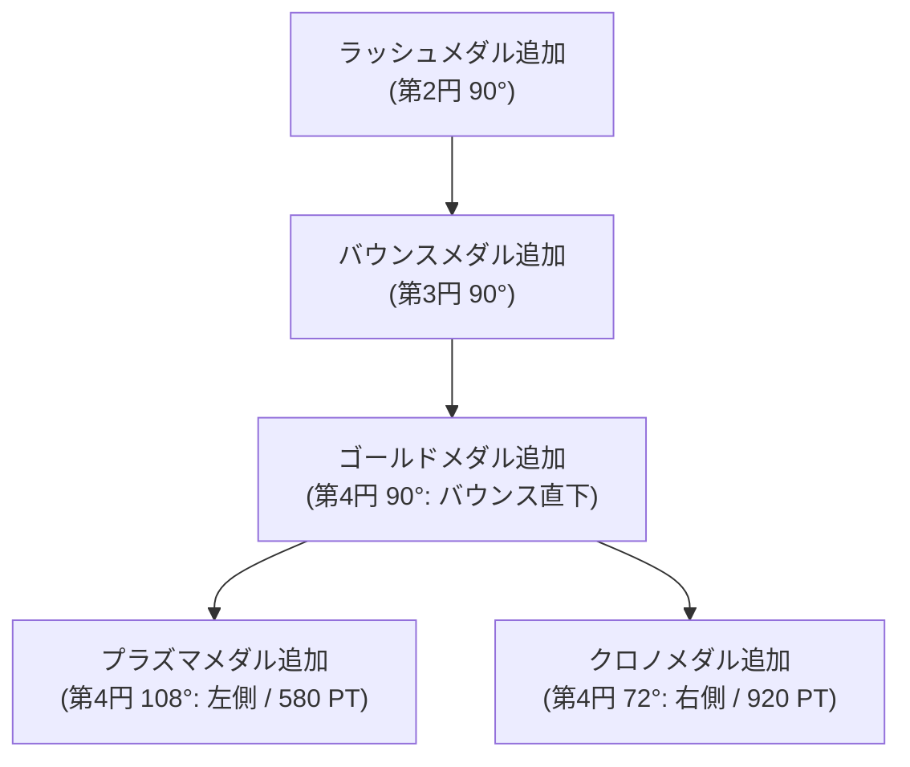

# 実装ウォークスルー (walkthrough.md) — メダル開放ラインのT字分岐（バウンス直下にゴールド、左右にプラズマ・クロノ）再編

ユーザーのご指示に基づき、スキルツリー下部（6時方向）のメダル開放ラインを、一筆書き円弧から **美しいT字分岐（アンカー型）** へ再編しました。

---

## 1. 再編後のメダル開放ツリー

バウンスの真下にゴールドメダルが垂直に直進配置され、ゴールドから左右にプラズマ（左側: 580 PT）とクロノ（右側: 920 PT）が分岐する幾何学的構造を構築しました。

---

## 2. 導線とゲームバランス

- **直進ルート**:
  - `制限時間延長 I`（第1円 90°） → `ラッシュメダル追加`（第2円 90° / 70 PT） → `バウンスメダル追加`（第3円 90° / 180 PT） → **`ゴールドメダル追加`（第4円 90° / 360 PT）**
- **左右T字分岐**:
  - ゴールドメダルを取得すると、左右の特殊メダルが同時に解放可能になります。
  - **プラズマメダル（左側: 108°）**: 580 PT
  - **クロノメダル（右側: 72°）**: 920 PT
  - クロノの要求PTが高いため、プレイヤーは必然的にプラズマを先に取得し、最終奥義としてクロノを目指す自然なゲーム進行となります。
